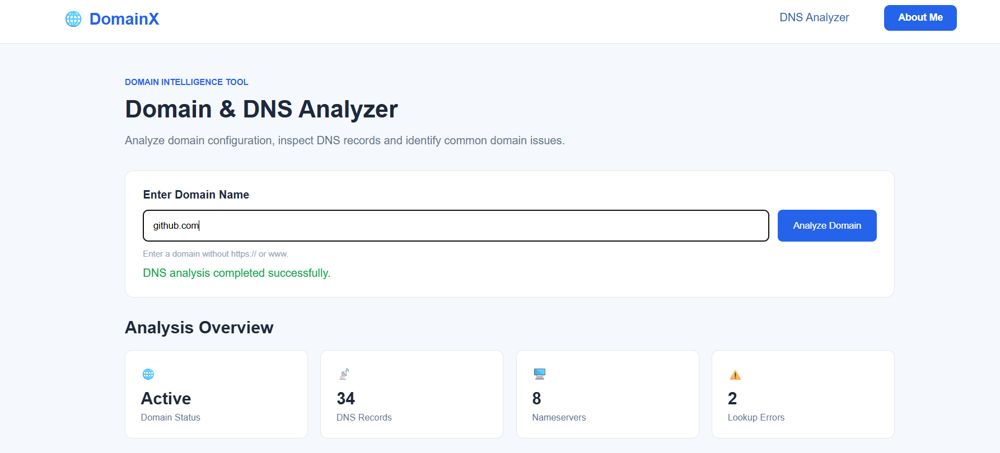
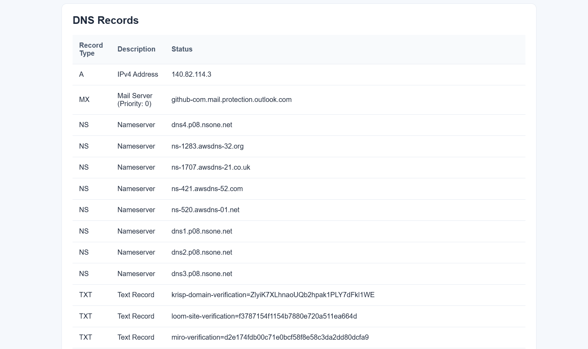
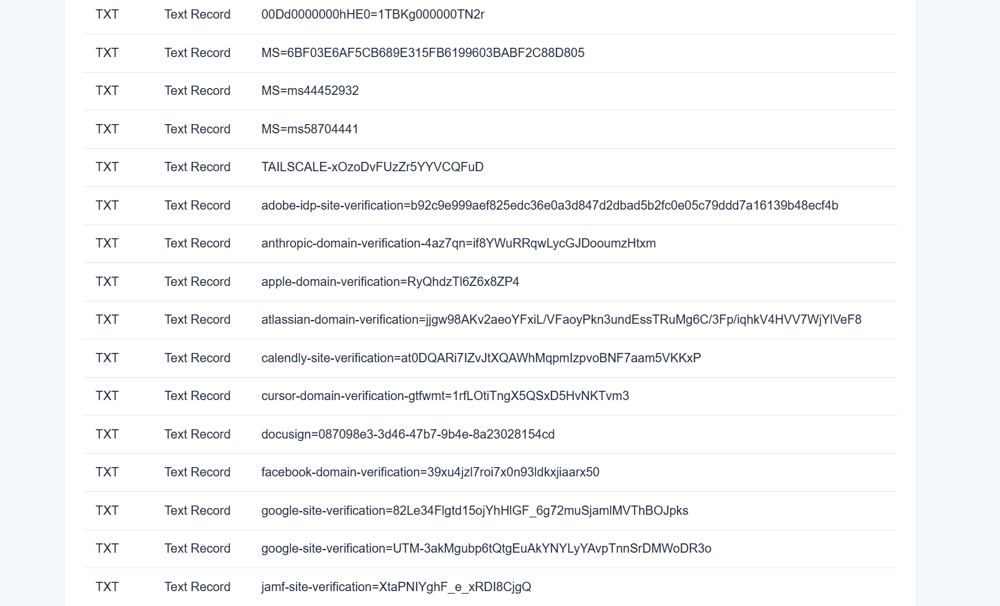
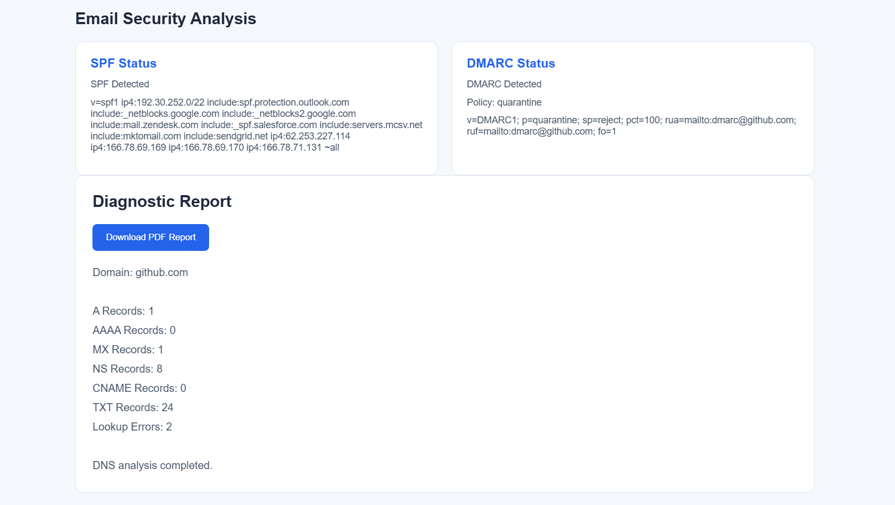

# 🌐 DomainX – Domain & DNS Management System

**DomainX** is a web-based domain and DNS analysis tool that helps users inspect DNS records, identify email-security configurations and generate downloadable diagnostic reports through a simple dashboard.

## 🌐 Live Demo

🚀 **[Try DomainX Live](https://domain-x-dns-analyzer.vercel.app/)**

## ✨ Features

- **DNS Record Lookup:** Retrieve A, AAAA, MX, NS, CNAME and TXT records.
- **Domain Analysis:** View domain status, DNS record counts, nameservers and lookup errors.
- **Email Security Analysis:** Detect SPF and DMARC information.
- **Diagnostic Report:** Generate and download PDF reports.
- **Error Handling:** Display lookup errors and support partial DNS results.
- **User-Friendly Interface:** Clean and responsive dashboard.
- **About Me Section:** Displays developer information and technical skills.

## 🛠️ Technologies Used

| Technology | Purpose |
|---|---|
| HTML5 | Webpage structure |
| CSS3 | Styling and layout |
| JavaScript | Frontend functionality |
| Node.js | Backend runtime |
| Express.js | Backend server and API routing |
| jsPDF | PDF report generation |
| DNS Lookup | Retrieving DNS records |
| Git & GitHub | Version control |
| Vercel | Deployment |

## 📸 Project Screenshots

### 1. Main Dashboard

The dashboard displays domain status, DNS record counts, nameservers and lookup errors.

### 2. DNS Records Analysis

View available DNS records, including A, MX, NS and other record types.

### 3. TXT Records

Inspect domain verification information and email-security-related TXT records.

### 4. Email Security Analysis

Check SPF and DMARC information and view the diagnostic report.

## 🔍 DNS Records Explained

| Record | Description |
|---|---|
| A | Maps a domain to an IPv4 address |
| AAAA | Maps a domain to an IPv6 address |
| MX | Identifies mail servers |
| NS | Identifies authoritative nameservers |
| CNAME | Creates an alias for another hostname |
| TXT | Stores text-based DNS information |

## 🔐 Email Security Checks

**SPF (Sender Policy Framework)**

Identifies which servers are authorized to send emails for a domain.

**DMARC (Domain-based Message Authentication, Reporting and Conformance)**

Defines how receiving email systems should handle messages that fail relevant authentication checks and can provide reports.

## ⚙️ Run Locally

### 1. Clone the repository

git clone https://github.com/royalharry007/DomainX-DNS-Analyzer

### 2. Open the project directory

cd DomainX

### 3. Install dependencies

npm install

### 4. Start the server

node server.js

### 5. Open in your browser

http://localhost:3000

*Use the port configured in your server.js if it differs from 3000.*

## 🎯 Project Objective

The objective of DomainX is to simplify domain and DNS analysis by bringing multiple DNS lookups and basic email-security checks together in one accessible dashboard.

## 👨‍💻 Developed By

**Harichand Chauhan**

Computer Science Engineering Student  
Pandit Deendayal Energy University

- GitHub: [@royalharry007](https://github.com/royalharry007)
- Live Project: [DomainX](https://domain-x-dns-analyzer.vercel.app/)

---

⭐ If you find this project useful, feel free to explore it!
